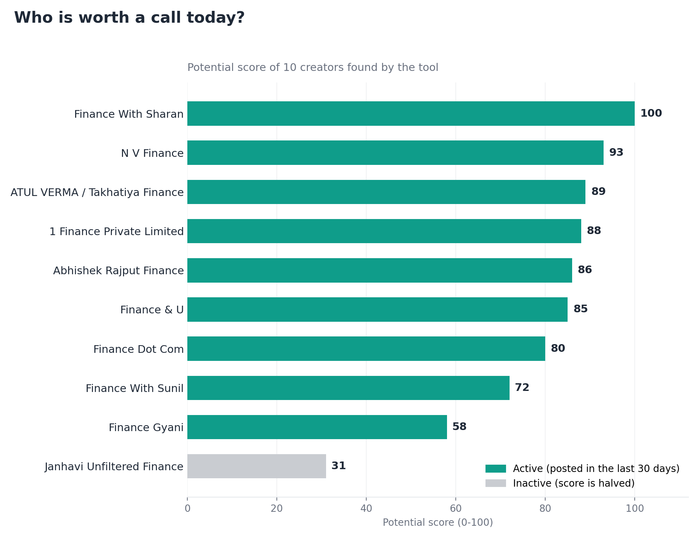
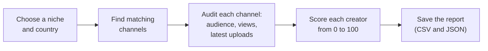
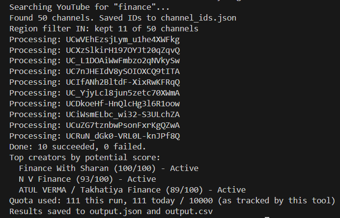
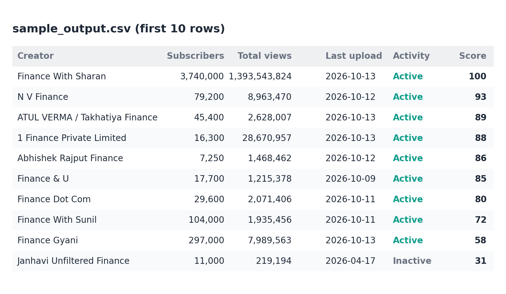
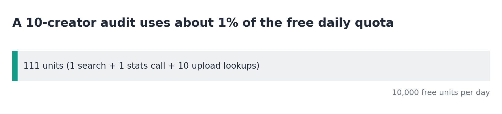
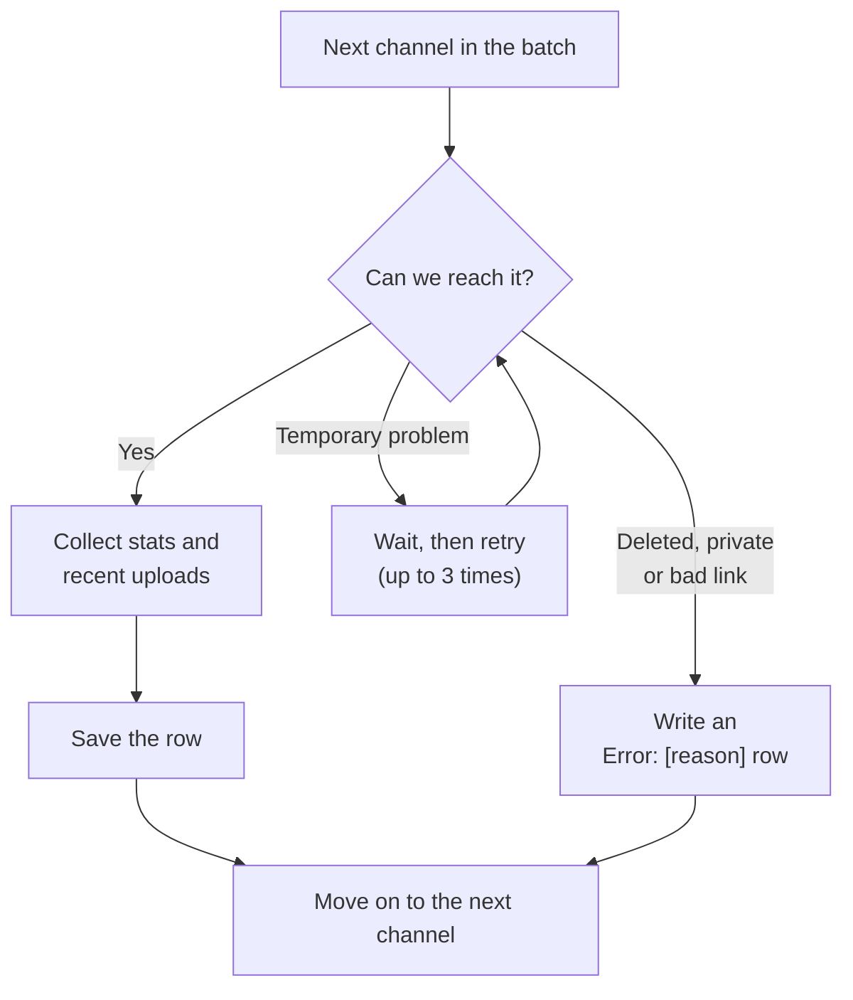
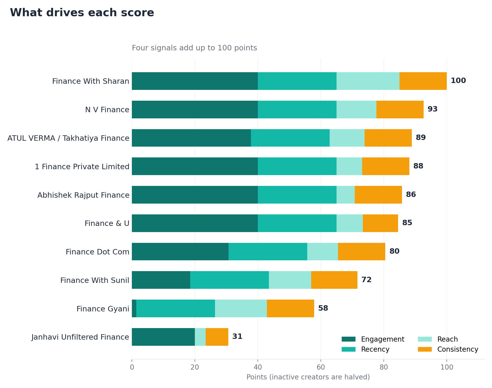

# Influencer Discovery & Audit Tool


A Python command-line tool that finds YouTube creators in a niche, checks how big and how active they are, and ranks them with a simple score. It uses the free YouTube Data API v3, reads metadata only (no videos are ever downloaded), and keeps going when individual channels are broken, deleted or restricted.

*Example output: 10 Indian finance creators ranked from 0 to 100 on how active and engaging they are. Teal bars posted in the last 30 days; grey bars have gone quiet.*



[Setup](#setup) · [Search options](#configuring-the-search-parameters) · [Authentication](#handling-authentication) · [Output](#output) · [Free-tier limits](#staying-within-the-free-limits)

> [!TIP]
> After setup, one command finds, audits and ranks creators:
> ```bash
> python discovery_engine.py --keyword finance --region IN --strict-region --language en --max-channels 10 
> ```

## What it does

You give it a niche (for example `finance`) and optionally a country. It finds matching channels, audits each one and writes a ready-to-use report.



- **Lead discovery:** search by keyword with optional region and language filters. Channel IDs are saved to `channel_ids.json` for batch processing.
- **Audit trail:** subscribers, total views, video count and the upload dates of the 5 to 10 most recent videos, in `YYYY-MM-DD` (UTC).
- **Resilience:** a broken, deleted or restricted channel produces an `Error: [description]` row and the rest of the batch is still processed.
- **Rate limiting:** a mandatory 2-second delay before every request.
- **Live progress:** the terminal prints `Processing: [URL/ID]` as it works.
- **Structured output:** results are a list of dictionaries, saved as `output.json` and `output.csv`.

## Sample results

The chart above comes from a real run on Indian finance creators. This is the command, and the live progress it prints:

```bash
python discovery_engine.py --keyword finance --region IN --strict-region --language en --max-channels 10
```



And the report it produces, ranked by potential score:



The full results are in `sample_output.csv`, audited on 14 October 2026. Spreadsheet apps may display the dates in your regional format, but the file itself uses `YYYY-MM-DD`. A second run with deliberately broken inputs, showing the error handling, is in `sample_output_errors.csv`:

```text
Processing: @googledevelopers
Processing: UClECEb3c-nxpNPbaIsDeprA
Processing: @this-handle-does-not-exist-12345
Error: Channel not found, deleted, or restricted
Processing: https://www.youtube.com/channel/UCfakefakefakefakefake00
Error: Channel not found, deleted, or restricted
Processing: https://example.com/not-a-youtube-link
Error: unsupported or malformed channel URL
Done: 2 succeeded, 3 failed.
```

## Setup

Requires Python 3.7 or newer. The code avoids newer-only syntax and the dependencies are pinned to versions that support 3.7. It was developed and run on Python 3.11.

```bash
git clone https://github.com/parineetarao/influencer-discovery-engine
cd influencer-discovery-engine
python -m venv venv

# Windows:
venv\Scripts\activate
# macOS / Linux:
source venv/bin/activate

pip install -r requirements.txt
```

**Updating libraries:** the pinned versions (`requests==2.31.0`, `python-dotenv==0.21.1`) are the last releases that support Python 3.7. On Python 3.8 or newer you can upgrade them with `pip install --upgrade requests python-dotenv`.

### Get a free API key

1. Open the Google Cloud Console and create or select a project.
2. Go to **APIs & Services → Library**, search for **YouTube Data API v3**, and click **Enable**.
3. Go to **APIs & Services → Credentials → Create credentials → API key**.
4. Recommended: restrict the key to the YouTube Data API v3.
5. Copy `.env.example` to `.env` and paste your key:

```
YOUTUBE_API_KEY=your_key_here
```

`.env` is listed in `.gitignore`, so your key is never committed.

## Configuring the search parameters

| Option | Meaning | Example |
|---|---|---|
| `--keyword` | Niche keyword to search for (required unless an input option is used) | `--keyword finance` |
| `--region` | Two-letter country code | `--region IN` |
| `--strict-region` | Keep only channels whose declared country equals `--region` | `--strict-region` |
| `--language` | Language relevance hint | `--language en` |
| `--max-channels` | Number of creators to audit (default 10) | `--max-channels 25` |
| `--recent` | Recent uploads to audit, 5 to 10 (default 5) | `--recent 10` |
| `--active-days` | A channel is "Active" if it posted within this many days (default 30) | `--active-days 45` |
| `--input-file` | Audit a list of channel URLs, `@handles` or IDs instead of searching | `--input-file sample_input.txt` |
| `--from-ids-file` | Reuse the IDs saved by a previous search (costs no search quota) | `--from-ids-file` |
| `--ids-file` | Where discovered channel IDs are stored (default `channel_ids.json`) | `--ids-file my_ids.json` |
| `--no-cache` | Ignore saved audits and fetch everything fresh | `--no-cache` |
| `--cache-hours` | Reuse a saved audit if it is newer than this many hours (default 24) | `--cache-hours 6` |

> [!NOTE]
> `--region` on its own is only a relevance hint to YouTube's search. Add `--strict-region` when you need a hard filter.

```bash
# Discover finance creators in India and audit the top 10
python discovery_engine.py --keyword finance --region IN --strict-region --language en --max-channels 10

# Audit a specific list of channels
python discovery_engine.py --input-file sample_input.txt --recent 5

# Re-run the audit on previously discovered channels without searching again
python discovery_engine.py --from-ids-file
```

**Input file format.** One entry per line. Accepted forms: a channel ID (`UC...`), an `@handle`, `youtube.com/@handle`, `youtube.com/channel/UC...` and `youtube.com/user/name`. Blank lines and lines starting with `#` are ignored, and duplicates are removed. Legacy `/c/customname` URLs are not supported and produce an error row.

## Handling authentication

Channel statistics and public upload dates are public metadata, so an API key is all that is needed for normal use. The tool never downloads media, so age restrictions on individual videos do not block metadata retrieval.

For restricted cases, the tool supports an OAuth access token as an alternative to the key. Set it in `.env`:

```
YOUTUBE_OAUTH_TOKEN=your_oauth_access_token
```

When `YOUTUBE_OAUTH_TOKEN` is present it is sent as a `Bearer` token and the API key is not used. A token can be created with the `https://www.googleapis.com/auth/youtube.readonly` scope (for example through Google's OAuth 2.0 Playground). Access tokens expire after about an hour, so generate a fresh one for each session.

## Output

Results are written to `output.json` (a list of dictionaries) and `output.csv`, sorted by potential score with errors last.

| Column | Meaning |
|---|---|
| `channel_id`, `channel_name`, `country` | Identity. Country is `Not specified` if the channel does not declare one. |
| `subscribers` | Audience size, or `Metric restricted` if the channel hides it |
| `total_views`, `video_count` | Channel totals, or `Metric restricted` if unavailable |
| `recent_upload_dates` | Dates of the most recent uploads, newest first, `YYYY-MM-DD` (UTC) |
| `last_upload_date` | Newest upload date, or `Date not found` |
| `days_since_last_upload` | Days between the last upload and the day of the run |
| `avg_days_between_uploads` | Average gap across the recent uploads |
| `activity` | `Active` or `Inactive` (see `--active-days`) |
| `avg_views_per_video` | Total views divided by video count |
| `potential_score` | 0 to 100 score described below, or `N/A` |
| `status` | `OK` or `Error: [description]` |

Fields that cannot be computed show `N/A`. Because `days_since_last_upload` and `activity` are relative to the day of the run, read them next to the run date.

## Staying within the free limits

The YouTube Data API gives each project a free daily quota (10,000 units at the time of writing; check the Cloud Console for your project). Requests differ greatly in cost, so the tool is built around the cheap ones:



| Request | Approx. cost | How it is used |
|---|---:|---|
| `search` | 100 units | One search per run, never one per video |
| `channels` | 1 unit | Up to 50 channels per request |
| `playlistItems` | 1 unit | One request per channel for its latest uploads |

A 10-creator audit costs roughly 111 units, about 1% of the daily quota. Other optimizations:

- `fields` and minimal `part` parameters keep every response small.
- Strict region filtering runs before the per-channel uploads request, so filtered-out channels cost nothing more.
- Audited channels are cached in `.audit_cache.json` for 24 hours, so repeat runs and interrupted batches cost almost nothing. Use `--no-cache` for fresh data.
- Units used are tracked in `.quota_state.json` and reset when the Pacific-time day changes, and a request that would exceed the daily limit is refused. The tool only counts its own usage on this machine, so the Cloud Console remains the source of truth.

## Reliability



| If this happens... | The tool... |
|---|---|
| A channel is deleted, private or the link is wrong | Writes `Error: [description]` and continues with the batch |
| A creator hides their subscriber count | Shows `Metric restricted` |
| A date is missing | Shows `Date not found` |
| YouTube has a temporary problem (HTTP 429, 5xx, network) | Retries up to 3 times with increasing waits |
| The daily quota is nearly used up | Stops safely instead of failing halfway |

The 2-second delay is enforced in one place, before every request, retries included. Error messages never include the API key.

## Potential score

A simple, explainable score out of 100, calculated from data already fetched (no extra quota):

| Part | Points | Rule |
|---|---:|---|
| Engagement | 40 | Average views per video divided by subscribers; full marks at 25% or more |
| Recency | 25 | Full marks if the last upload was within 7 days, falling to 0 at 60 days |
| Reach | 20 | Log-scaled subscribers: 0 at 1K, full marks at 1M or more |
| Consistency | 15 | Full marks if uploads average 3 days apart or less, falling to 0 at 30 days |

Channels that are not active have their score halved. If data is missing, the score is `N/A` instead of a guess.



Each bar shows how the four signals add up for the creators in the sample run.

## Limitations

- Keyword search mainly matches channel names and descriptions, so results are channels named after the niche rather than every channel that covers it.
- Search returns a limited number of results per query, and strict region filtering can leave fewer channels than `--max-channels`. Channels with no declared country are dropped in strict mode.
- Country is self-declared by the channel, and many channels leave it blank.
- The score is a heuristic without ground truth. Engagement uses lifetime averages, and recent uploads can include Shorts. Corporate channels can also score highly.
- Dates are in UTC, and cached results can be up to `--cache-hours` old.

## Project structure

```
influencer-discovery-engine/
├── discovery_engine.py                 the tool
├── requirements.txt                    pinned dependencies
├── .env.example                        template for your API key
├── .gitignore                          keeps .env, cache and quota files out of git
├── sample_input.txt                    example input file
├── sample_output.csv / .json           sample audit of 10 creators
├── sample_output_errors.csv / .json    sample run showing error handling
└── docs/
    ├── results_chart.png               ranking chart used in this README
    ├── score_breakdown.png             score composition chart
    ├── report_preview.png              first rows of the report
    ├── terminal.png                    screenshot of a live run
    ├── quota_bar.png                   free-quota usage graphic
    └── make_chart.py                   regenerates the charts from sample_output.csv
```

## About the builder

I'm Parineeta Rao, a final-year B.Tech student in AI & Data Science. I like building AI solutions, making sense of data, and streamlining workflows. 
[LinkedIn](https://www.linkedin.com/in/parineeta-rao-14097a355) · [GitHub](https://github.com/parineetarao)